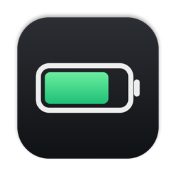

<p align="center">
  
</p>

<h1 align="center">Eighty</h1>

<p align="center">
  <b>Free battery protection for MacBooks that stay plugged in.</b><br>
  Stops charging at 80%, and pauses charging while the battery is hot.
</p>

<p align="center">
  
  <br>
  <sub>Numbers: <a href="https://batteryuniversity.com/article/bu-808-how-to-prolong-lithium-based-batteries">Battery University BU-808</a>, tables 3 and 4. Estimates for typical Li-ion cells; real batteries vary.</sub>
</p>

## Why

A Mac that sits on its charger all day keeps its battery full and often warm.
Those are the two things that wear a battery out fastest. Eighty fixes both:

- **Charge limit.** Charging stops at 80% (or any limit you pick), and the Mac runs
  straight from the charger.
- **Heat pause.** If the battery gets hot while charging (35 °C by default),
  charging pauses until it cools down.

Heat protection is usually a paid feature. Eighty is free and open source.

| | Charge limit | Heat pause | Price |
|---|:-:|:-:|---|
| **Eighty** | ✅ | ✅ | Free |
| AlDente | ✅ | Pro only | €23.99 for Pro |
| BatFi | ✅ | ✅ | $15 |
| batt, battery | ✅ | — | Free |
| macOS built-in | 80–95% steps | — | Free |

Needs an Apple silicon MacBook on **macOS 27** or later.

## Install

```sh
brew install --cask nathancolosimo/tap/eighty
```

1. Open **Eighty** from Applications. A shield appears in the menu bar.
2. Click it, then **Install Background Service**. macOS asks for your password once.

That's it. Eighty starts with your Mac from then on.

## Use

Click the menu bar icon to:

- see battery %, temperature, and what Eighty is doing,
- set the charge limit (slider, or 80% / 90% / Full),
- turn the heat pause on or off, and set its temperature.

| Menu bar | Means |
|---|---|
| 🛡 80 | Charging stops at 80% |
| 🛡 | No limit |
| 🌡 63 | Paused for heat, holding at 63% |
| ⚠️ shield | Something is wrong. Open the menu for details and a fix. |

Before a trip, click **Full** to charge to 100%. Set it back to 80% when you're home.

## For AI agents and scripts

Everything in the app is also in the `eighty` command, which the cask puts on your PATH.

```sh
brew install --cask nathancolosimo/tap/eighty
sudo eighty install          # start the background service (once)
eighty status --json         # read state
eighty limit 80              # charge limit, 10-100 (100 = off)
eighty heat 35 32            # pause at 35 °C, resume at 32 °C
eighty heat off
eighty history 60            # last 60 minutes as CSV
eighty help                  # all commands; `eighty help <command>` for details
```

- Only `install` and `uninstall` need sudo. Other changes apply within seconds.
- Exit code 0 on success, 1 on error, with the error on stderr.
- `status --json` returns one object; `problem` is `null` when healthy:

```json
{"battery":{"percent":79,"charging":true,"temperatureC":31.2},"limit":80,
 "heat":{"pauseAt":35,"resumeAt":32},"macosTarget":80,"enforcing":[80],
 "problem":null,"daemon":{"installed":true,"mode":"limit","lastSample":"2026-11-24T18:24:29-05:00"}}
```

## Uninstall

```sh
brew uninstall --zap --cask eighty
```

`--zap` also stops and removes the background service (macOS asks for your
password). macOS keeps a plain charge limit at your last setting; change it in
System Settings → Battery. A plain `brew uninstall` removes only the app and leaves
the service running.

## Good to know

- **Don't combine it with other limiters** (AlDente, batt, or the System Settings
  charge slider). They all set the same macOS limit and will fight.
- **Above the limit, macOS runs the Mac from the battery** until it drops to the
  limit, even while plugged in.
- **macOS updates can break it.** Eighty uses private macOS interfaces; the menu
  bar shows a warning if it stops working.
- **The app isn't notarized** (that needs a paid Apple developer account). The
  Homebrew cask clears the download quarantine so it opens normally. Each release's
  build provenance can be checked with
  `gh attestation verify Eighty-<version>.zip --repo NathanColosimo/eighty`.

## How it works

The background service runs as root, wakes once a minute, and sets macOS's own
built-in charge limit, including exact targets the System Settings slider doesn't
offer. It reads battery temperature from the SMC sensors. If the battery is charging
and too hot, it sets the limit to the current percentage so charging stops there,
and restores your limit once the battery cools. The app and CLI change settings in
`/Library/Application Support/eighty/config.json`; history and errors go to
`/Library/Logs/eighty/`.

## Build from source

```sh
git clone https://github.com/NathanColosimo/eighty && cd eighty
swift test
scripts/build-app.sh --install    # builds Eighty.app into /Applications
```

Releases: see [docs/RELEASING.md](docs/RELEASING.md). Security reports: see
[SECURITY.md](SECURITY.md).

## License

[MIT](LICENSE). Charge-limit approach based on
[batt](https://github.com/charlie0129/batt)'s macOS 27 backend.
