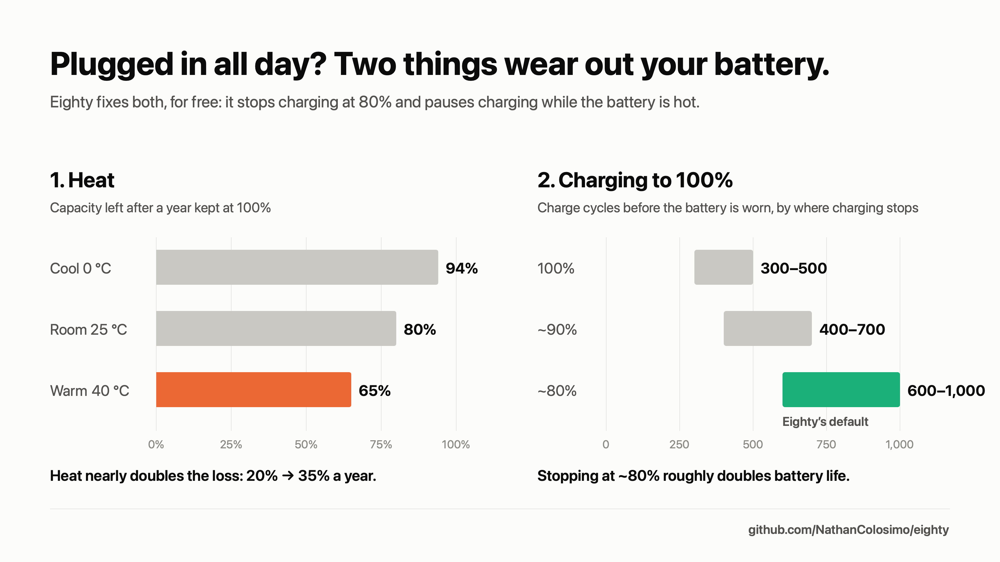

<p align="center">
  
</p>

<h1 align="center">Eighty</h1>

<p align="center">
  <b>Free battery protection for MacBooks that stay plugged in.</b><br>
  Stops charging at 80%, and pauses charging while the battery is hot.
</p>

<p align="center">
  
  <br>
  <sub>Source: <a href="https://batteryuniversity.com/article/bu-808-how-to-prolong-lithium-based-batteries">Battery University BU-808</a> (estimates; real batteries vary)</sub>
</p>

A Mac that lives on its charger keeps its battery full and often warm, the two
things that wear it out fastest. Eighty fixes both, from a small menu bar app:

- **Charge limit:** charging stops at 80% (or your pick) and the Mac runs from the charger.
- **Heat pause:** if the battery gets hot while charging, charging waits until it cools.

| | Charge limit | Heat pause | Price |
|---|:-:|:-:|---|
| **Eighty** | ✅ | ✅ | **Free, open source** |
| AlDente | ✅ | Pro only | €23.99 |
| BatFi | ✅ | ✅ | $15 |
| macOS built-in | 80–95% | — | Free |

Requires an Apple silicon MacBook on macOS 27 or later.

## Install

```sh
brew install --cask nathancolosimo/tap/eighty
```

Open **Eighty**, click the shield in the menu bar, then **Turn On Background Service**,
and allow Eighty in the System Settings page that opens. To update, run
`brew upgrade --cask eighty`; the background service restarts on the new version.

## Use

Click the menu bar icon to set the charge limit and the heat pause.

| Menu bar shows | Means |
|---|---|
| Shield and **80** | Charging stops at 80% |
| Shield only | No limit |
| Thermometer and **63** | Paused for heat at 63% |
| Shield with **!** | Not working; open the menu to fix it |

Going on a trip? Click **Full** to charge to 100%, and **80%** when you're back.

## For AI agents and scripts

The `eighty` command reads and changes everything the app does, without sudo. Only
turning on the background service needs the app, because macOS asks a person to allow it.

```sh
eighty status --json     # state as JSON; "problem" is null when healthy
eighty limit 80          # 10-100, 100 = no limit
eighty heat 35 32        # pause at 35 °C, resume at 32 °C (or: eighty heat off)
eighty history 60        # last hour, one CSV row per minute
eighty help [command]    # full reference
```

Exit code 0 on success, 1 on error (message on stderr).

## Uninstall

```sh
brew uninstall --zap --cask eighty
```

## Good to know

- **Use one limiter.** AlDente, batt, and the System Settings charge slider set the
  same macOS limit as Eighty and will fight it.
- **Above the limit, the battery drains to it** even while plugged in. That's macOS
  doing what it should.
- **It relies on private macOS interfaces**, so a macOS update could break it. If
  that happens, the menu bar icon turns into a warning.

## How it works

A small background service runs as root, wakes once a minute, and sets macOS's own
charge limit. It runs from inside the app, registered with macOS's `SMAppService`,
so it upgrades with the app. Turn it off in System Settings → General → Login
Items & Extensions. When the battery is charging and hot, it sets the limit to the
current percentage so charging stops, then restores it once the battery cools.
Releases are signed and notarized by Apple.

## Development

```sh
swift test
scripts/build-app.sh --install    # build Eighty.app into /Applications
```

[Releasing](docs/RELEASING.md) · [Security](SECURITY.md) · [MIT License](LICENSE) ·
Charge-limit approach from [batt](https://github.com/charlie0129/batt).
